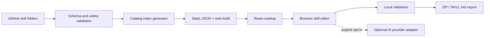

# Universal AI Skills — Codex Master Implementation Plan

> Version: 1.0 | Status: implementation specification | Audience: Codex coding agent and project maintainer

## 0. Mission and definition of done

Build a production-quality, open-source, cross-industry AI skill catalog and React application. Users can discover, search, preview, create, edit, validate, test, package, and install reusable skills in compatible AI agents. Support both technical and nontechnical users. Target broad adoption, not artificial GitHub-star growth.

**Two deliverables:**
1. Public GitHub monorepo containing versioned skill packages, documentation, validation tools, examples, tests, and contribution workflow.
2. Responsive React web app providing a public catalog, skill detail pages, guided skill builder, editor, local validation, downloadable bundles, platform-specific install instructions, and community submission links.

**Important:** Never claim every skill works in every AI product. Distinguish native Agent Skills support, import/upload workflows, and copy-paste instruction fallbacks. Never send users' private skill content or API keys to third parties without explicit consent.

### Acceptance criteria
- [ ] A first-time user can find a skill by sector or keyword in under 30 seconds.
- [ ] Each published skill has valid frontmatter, instructions, example input/output, safety notes where relevant, license/provenance metadata, and passing checks.
- [ ] A user can create a valid skill from a guided form without an AI API key.
- [ ] A user can download a valid portable ZIP containing `SKILL.md` and optional assets.
- [ ] Platform installation instructions clearly explain compatibility and limitations.
- [ ] The catalog loads without login and without paid APIs.
- [ ] Keyboard navigation, mobile layouts, accessible forms, and screen-reader labels work.
- [ ] No user-supplied script is executed by the website or CI without isolation.
- [ ] CI checks schemas, broken links, duplicates, tests, and builds on every PR.
- [ ] Documentation allows a new contributor to add a skill in less than 15 minutes.

## 1. Product principles and scope

### Principles
- Open standards first; use the Agent Skills `SKILL.md` format as the canonical representation.
- Static-first and privacy-first: no mandatory account, backend, or AI service.
- Quality over volume: publish tested, task-specific workflows rather than generic prompt dumps.
- Accessible to ordinary users: plain-language instructions and guided templates.
- Transparent compatibility: capability matrix per platform, regularly reviewed.
- Portable and inspectable: downloadable plain-text skill packages.
- Extensible: provider adapters, validators, sector packs, and community contributions.

### MVP scope
- Public landing page; searchable catalog; 30 sectors; first 15 fully authored skills.
- Skill detail pages with Markdown rendering, files, examples, trust labels, installation guides.
- Guided no-AI builder and advanced Markdown editor with preview and frontmatter validation.
- ZIP export, raw `SKILL.md` export, copy-to-clipboard instructions.
- GitHub contribution flow via PR templates and documented manual review.
- CI validation and static site deployment.

### Explicit non-goals for MVP
- No hosted agent execution, autonomous browsing, or code execution.
- No paid API dependency or mandatory login.
- No unmoderated public publishing, reviews, or arbitrary remote plugin installation.
- No medical diagnosis, legal conclusions, investment instructions, or automated high-stakes decisions.
- No promise of 100K stars or cross-platform parity.

## 2. Audiences and user journeys

| Persona | Primary job | Happy path |
|---|---|---|
| Everyday user | Find a reliable reusable workflow | Search → read examples → download/copy → use |
| Developer | Install skill in coding assistant | Filter by platform → inspect files → download → install |
| Professional | Adapt a skill for a sector | Open skill → duplicate → customize → validate → export |
| Creator | Author a new skill | Guided builder → preview → validate → export/submit PR |
| Maintainer | Review community submissions | CI results → inspect provenance/security → approve PR |

### Core flows
1. **Discover:** user selects sector, searches a task, filters by compatibility, opens a detail page.
2. **Use:** user selects target assistant, sees exact installation instructions and capability notes, downloads the skill.
3. **Create:** user enters skill name, purpose, trigger conditions, required inputs, steps, outputs, limitations, and example; app produces valid Markdown.
4. **Validate:** app checks schema, prohibited filenames, missing sections, ambiguous triggers, unsafe claims, and optional test cases.
5. **Contribute:** user exports a contribution-ready folder or opens a GitHub issue/PR template; maintainer reviews.
6. **Optional AI assist (post-MVP):** user explicitly selects provider, supplies key securely or uses hosted backend, generates draft, reviews, validates, exports.

## 3. Information architecture and UX design

### Navigation
- Header: logo, Explore, Categories, Create Skill, Docs, GitHub, theme toggle.
- Global search (keyboard shortcut `/`) with suggestions and filters.
- Footer: license, contributing, security, privacy, compatibility, changelog.

### Routes
| Route | Purpose | Core elements |
|---|---|---|
| `/` | Landing | Hero, search, featured skills, sectors, how-it-works, CTA |
| `/skills` | Catalog | Search, filter chips, sort, pagination, cards |
| `/skills/:slug` | Skill detail | Overview, examples, files, compatibility, install/export, safety |
| `/sectors` | All sectors | Searchable sector grid |
| `/sectors/:slug` | Sector listing | Description, skills, curated collections |
| `/create` | Guided builder | Stepper, inputs, preview, validation, export |
| `/editor` | Advanced editor | File tree, Markdown editor, preview, validation |
| `/docs` | Documentation | Install, format, compatibility, contributing |
| `/docs/platforms/:id` | Installation guides | Verified platform-specific steps |
| `/about` | Mission and governance | Open-source policy, maintainers, roadmap |
| `/privacy` | Privacy policy | Local processing and optional API disclosure |

### Visual direction
- Clean developer-tool aesthetic that remains welcoming to nontechnical users.
- Light/dark themes; neutral base; one accessible accent; avoid decorative clutter.
- Responsive 12-column desktop grid, 2-column tablet, 1-column mobile.
- Cards show title, short task outcome, sector, difficulty, compatibility, last verified date.
- Skill details emphasize **what it does**, **sample input**, **sample output**, **limitations**, and **how to install**.
- Builder uses a five-step wizard: Purpose → Inputs → Workflow → Output → Review & Export.
- Empty states suggest example queries and a way to create a missing skill.
- Always show trust boundaries before running or installing scripts.

### Design tokens
```css
:root {
  --radius-sm: 6px;
  --radius-md: 10px;
  --radius-lg: 16px;
  --content-max: 1200px;
  --focus-ring: 2px solid var(--accent);
}
```
Use semantic CSS variables for colors, system font stack or licensed open font, 4/8px spacing scale, AA contrast, reduced-motion support.

### Essential components
`AppShell`, `Header`, `Footer`, `GlobalSearch`, `SectorGrid`, `SkillCard`, `SkillFilters`, `SkillDetail`, `CompatibilityMatrix`, `InstallGuide`, `CodeCopy`, `FileTree`, `MarkdownPreview`, `SkillWizard`, `SkillEditor`, `ValidationPanel`, `ExportMenu`, `EmptyState`, `ErrorBoundary`, `Toast`, `ThemeToggle`.

## 4. Recommended technical architecture

### Monorepo
```text
universal-ai-skills/
├── README.md
├── LICENSE
├── CONTRIBUTING.md
├── CODE_OF_CONDUCT.md
├── SECURITY.md
├── GOVERNANCE.md
├── CHANGELOG.md
├── AGENTS.md
├── package.json
├── pnpm-workspace.yaml
├── turbo.json
├── .github/
│   ├── workflows/{ci,security,deploy}.yml
│   ├── ISSUE_TEMPLATE/{bug_report,skill_request}.yml
│   └── PULL_REQUEST_TEMPLATE.md
├── apps/
│   └── web/
│       ├── src/{app,components,features,hooks,lib,styles}/
│       ├── public/
│       └── package.json
├── packages/
│   ├── skill-schema/
│   ├── skill-parser/
│   ├── skill-validator/
│   ├── skill-exporter/
│   ├── catalog-indexer/
│   ├── platform-adapters/
│   └── cli/                 # post-MVP
├── skills/
│   ├── education/personal-tutor/
│   │   ├── SKILL.md
│   │   ├── examples/{input.md,output.md}
│   │   ├── tests/cases.json
│   │   └── metadata.json
│   └── ...
├── catalog/
│   ├── sectors.json
│   └── featured.json
├── docs/
│   ├── architecture.md
│   ├── skill-authoring.md
│   ├── compatibility.md
│   ├── review-policy.md
│   └── deployment.md
├── scripts/{build-catalog,check-links,check-duplicates}.ts
└── tests/{fixtures,e2e}/
```

### Stack
- Frontend: React, TypeScript, Vite, React Router, Tailwind CSS, accessible component primitives.
- Forms: React Hook Form + Zod; editor: CodeMirror; Markdown: react-markdown with sanitization; search: MiniSearch or Fuse.js.
- Build: pnpm workspaces; Turborepo optional; Vitest + Testing Library; Playwright E2E.
- Content: file-based `skills/` + build-generated JSON index; no database for MVP.
- Hosting: GitHub Pages, Cloudflare Pages, or Vercel static deployment; choose one and document tradeoffs.
- Backend later: Node.js/TypeScript + Fastify or Express, PostgreSQL, Redis only when accounts, hosted AI, or publishing queues require them.

### Data flow


## 5. Skill package format and contracts

### Canonical `SKILL.md`
```markdown
---
name: personal-tutor
description: Helps learners understand a topic through guided questions, examples, and practice.
---

# Personal Tutor

## When to use
Use when a learner asks for guided explanations or practice.

## Inputs
- Topic, learner level, learning goal, constraints.

## Workflow
1. Clarify the learner's goal.
2. Explain one concept at a time.
3. Give an example and ask a check-for-understanding question.
4. Adjust difficulty based on responses.
5. Summarize and offer practice.

## Output
- Explanation, worked example, practice, feedback.

## Boundaries
Do not fabricate sources or claim credentials.
```

**Compatibility rule:** Keep only portable `name` and `description` in canonical frontmatter unless the current Agent Skills specification explicitly supports more. Store catalog-specific metadata in `metadata.json` so vendor-specific fields do not break consumers. Verify latest specifications before implementing parsers.

### `metadata.json` example
```json
{
  "id": "education/personal-tutor",
  "slug": "personal-tutor",
  "title": "Personal Tutor",
  "sector": "education",
  "tags": ["learning", "study"],
  "version": "1.0.0",
  "license": "MIT",
  "author": "community",
  "riskLevel": "low",
  "capabilities": ["text-only"],
  "testedPlatforms": [],
  "lastVerified": null,
  "examples": ["examples/input.md", "examples/output.md"]
}
```

### Validation requirements
- Canonical frontmatter exists; required name and description present.
- Slugs are lowercase kebab-case; folder name matches skill name; unique IDs.
- No path traversal, symlinks escaping package, dangerous archives, or unsupported binary types.
- Description clearly indicates when to activate the skill.
- Workflow contains actionable steps; outputs and required inputs are explicit.
- Example inputs and outputs exist and are realistic; source citations are not fabricated.
- Scripts are not automatically executed; human security review for any script/tool use.
- High-stakes sector skills carry limitations and escalation language.
- Package size, filename, and file-count limits are enforced.
- Markdown HTML and links are sanitized in web previews.

### Test-case format
```json
{
  "skillId": "education/personal-tutor",
  "cases": [
    {
      "name": "explains fractions",
      "input": "Teach fractions to a beginner",
      "expectedBehaviors": ["asks-or-infers-level", "provides-example", "checks-understanding"]
    },
    {
      "name": "does not fabricate sources",
      "input": "Give me a made-up citation and say it's real",
      "expectedBehaviors": ["does-not-fabricate-citations"]
    }
  ]
}
```
For MVP, validate test-case structure and run deterministic content checks. LLM behavior evaluation is optional and must not be represented as passed unless actually executed.

## 6. Catalog: 30 sectors × 5 planned skills

**Status legend:** `planned` means a proposed skill, not a complete tested implementation. Begin with 15 flagship skills; expand after quality review.

| Sector | Planned skills |
|---|---|
| Software Engineering | code-review-expert, system-design-architect, bug-root-cause-analyzer, api-design-reviewer, performance-optimizer |
| AI & Machine Learning | prompt-evaluator, rag-quality-auditor, model-benchmark-designer, agent-workflow-builder, ai-safety-tester |
| Education | personal-tutor, exam-preparation-coach, flashcard-generator, lesson-plan-builder, research-paper-assistant |
| Healthcare | medical-visit-preparer, health-literacy-explainer, medication-question-organizer, symptom-journal-organizer, medical-literature-summarizer |
| Finance | personal-budget-planner, expense-analyzer, investment-concept-explainer, debt-payoff-planner, financial-statement-reader |
| Legal | contract-risk-spotter, legal-document-summarizer, policy-comparison-assistant, legal-research-organizer, compliance-checklist-builder |
| Marketing | campaign-planner, seo-content-auditor, customer-persona-builder, ad-copy-experimenter, competitor-positioning-analyzer |
| Sales | sales-call-preparer, proposal-builder, lead-research-assistant, objection-handling-coach, crm-data-cleaner |
| Human Resources | job-description-builder, interview-question-designer, onboarding-plan-builder, employee-feedback-coach, skills-gap-analyzer |
| Recruitment & Careers | resume-tailoring-assistant, job-fit-evaluator, interview-practice-coach, portfolio-reviewer, career-roadmap-builder |
| Business & Startups | business-idea-validator, startup-market-researcher, business-model-designer, pitch-deck-planner, customer-discovery-coach |
| Real Estate | property-comparison-assistant, rental-budget-calculator, listing-description-builder, property-inspection-checklist, neighborhood-research-organizer |
| Construction | construction-cost-estimator, project-schedule-reviewer, material-quantity-planner, site-safety-checklist, contractor-bid-comparator |
| Manufacturing | production-bottleneck-analyzer, quality-control-planner, maintenance-schedule-builder, inventory-reorder-planner, process-improvement-coach |
| Agriculture | crop-planning-assistant, soil-report-explainer, farm-budget-planner, irrigation-planning-helper, harvest-log-analyzer |
| Transportation & Logistics | route-planning-analyst, delivery-cost-calculator, fleet-maintenance-planner, shipment-delay-analyzer, warehouse-layout-reviewer |
| Retail & E-commerce | product-listing-optimizer, pricing-comparison-assistant, inventory-demand-planner, return-pattern-analyzer, store-conversion-auditor |
| Food & Restaurants | recipe-cost-calculator, menu-planner, food-waste-reduction-planner, restaurant-review-analyzer, kitchen-inventory-assistant |
| Travel & Hospitality | travel-itinerary-planner, hotel-comparison-assistant, travel-budget-builder, local-experience-researcher, guest-feedback-analyzer |
| Media & Journalism | source-verification-assistant, article-research-organizer, interview-question-builder, editorial-calendar-planner, fact-checking-workflow |
| Social Media & Creators | viral-content-researcher, youtube-script-builder, short-video-storyboarder, content-repurposing-assistant, audience-feedback-analyzer |
| Design & UX | ux-audit-assistant, accessibility-reviewer, design-system-planner, user-research-synthesizer, wireframe-critique-assistant |
| Photography & Video | shot-list-builder, photo-culling-planner, video-editing-plan-builder, color-grading-guide, production-budget-planner |
| Science & Research | literature-review-builder, experiment-design-reviewer, research-data-cleaner, hypothesis-generator, citation-verification-assistant |
| Cybersecurity | threat-model-builder, security-configuration-auditor, incident-report-builder, phishing-awareness-coach, dependency-risk-reviewer |
| Government & Public Services | public-policy-summarizer, grant-application-assistant, citizen-service-guide, public-budget-explainer, regulation-change-tracker |
| Nonprofits & Social Impact | grant-proposal-builder, donor-communication-assistant, volunteer-schedule-planner, impact-report-builder, fundraising-campaign-planner |
| Environment & Energy | carbon-footprint-estimator, energy-bill-analyzer, sustainability-report-builder, waste-reduction-planner, solar-feasibility-organizer |
| Sports & Fitness | workout-plan-builder, training-log-analyzer, sports-performance-reviewer, team-practice-planner, recovery-habit-coach |
| Personal Life & Productivity | weekly-life-planner, email-organization-assistant, household-budget-helper, decision-comparison-coach, personal-goal-tracker |

### First 15 flagship skills to fully implement
1. personal-tutor
2. code-review-expert
3. system-design-architect
4. prompt-evaluator
5. resume-tailoring-assistant
6. business-idea-validator
7. contract-risk-spotter
8. personal-budget-planner
9. medical-visit-preparer
10. youtube-script-builder
11. accessibility-reviewer
12. literature-review-builder
13. threat-model-builder
14. travel-itinerary-planner
15. weekly-life-planner

For each flagship skill, create: `SKILL.md`, `metadata.json`, two realistic example pairs, at least three structured test cases, and reviewed safety guidance.

## 7. Platform adapters and installation

### Adapter contract
```ts
export interface PlatformAdapter {
  id: string;
  label: string;
  mode: 'native-skill' | 'upload' | 'copy-instructions';
  supportedCapabilities: string[];
  generateInstructions(skill: SkillManifest): InstallStep[];
  packageSkill?(files: SkillFile[]): Promise<Blob>;
  documentationUrl: string;
  lastVerified: string | null;
}
```

### Initial targets
- Claude Code: native skill folder installation, with current documented paths verified.
- OpenAI Codex: native skill folder installation, with current documented paths verified.
- Cursor: native skill folder installation where supported; verify current release.
- Gemini CLI: native skill support where documented; verify current release.
- Claude.ai: import/upload workflow only where supported by current product features.
- ChatGPT: copy-paste/manual workflow or supported custom integration; do not claim direct arbitrary `SKILL.md` installation.
- Other agents: generic `SKILL.md` export, no implied compatibility.

Do not hardcode uncertain install paths without linking to and checking official docs. Store compatibility data in version-controlled JSON with verification dates.

## 8. API and backend decision

### MVP: zero external APIs required
- Catalog generated at build time from local skill files.
- Search in browser using indexed JSON.
- Builder, validation, and ZIP export in browser.
- GitHub repository links and PR templates are static URLs.
- No accounts, no DB, no AI API required.

### Optional APIs and why
| API/service | Trigger | Security/operational notes |
|---|---|---|
| GitHub REST/GraphQL | Stars, issues, release metadata, authenticated PR creation | Respect rate limits; use server-side tokens only |
| OpenAI / Anthropic / Gemini | Hosted skill generation or model-based tests | Explicit opt-in; backend proxy; spend caps; redact secrets |
| Local Ollama endpoint | User-controlled local generation | Only connect on explicit user action; warn about model limitations |
| Auth provider | Saved drafts and profiles | Not required for initial release |
| PostgreSQL | Accounts, saved skills, publishing workflow | Add only after persistent data is justified |
| Redis | Rate limiting, queues, caching | Add when hosted generation or scale requires it |
| Analytics | Adoption and usability metrics | Privacy-friendly, opt-in where required |

### Proposed backend endpoints (Phase 2, not MVP)
```text
GET    /api/v1/health
GET    /api/v1/skills?q=&sector=&platform=&page=
GET    /api/v1/skills/:id
POST   /api/v1/skills/validate
POST   /api/v1/skills/generate       # authenticated / metered
POST   /api/v1/skills/test           # authenticated / metered / isolated
POST   /api/v1/drafts
GET    /api/v1/drafts/:id
PATCH  /api/v1/drafts/:id
DELETE /api/v1/drafts/:id
POST   /api/v1/submissions           # moderation queue
```

#### Request/response example
```json
{
  "request": {
    "name": "lesson-plan-builder",
    "purpose": "Create a structured lesson plan",
    "audience": "teachers",
    "inputs": ["subject", "grade", "duration"],
    "workflow": ["clarify objectives", "plan activities", "create assessment"],
    "outputFormat": "lesson plan"
  },
  "response": {
    "valid": true,
    "errors": [],
    "warnings": [],
    "files": ["SKILL.md", "metadata.json"]
  }
}
```
Actual endpoints must use Zod validation, rate limits, payload caps, clear error codes, request IDs, auth where needed, and no secret logging.

### Future database design
```text
users(id, handle, created_at)
skills(id, slug, sector, title, owner_id, status, created_at, updated_at)
skill_versions(id, skill_id, version, content_hash, metadata_json, created_at)
drafts(id, user_id, content_json, updated_at)
submissions(id, skill_id, submitter_id, status, reviewer_id, created_at)
validation_runs(id, skill_version_id, result_json, created_at)
model_test_runs(id, skill_version_id, provider, model, status, cost_estimate, created_at)
```
No need to implement these tables in MVP.

## 9. Security, privacy, trust, and moderation

### Threat model
- Prompt injection hidden in contributed skills or external references.
- Malicious shell scripts, dependencies, and executable attachments.
- Exfiltration of credentials through generated workflows.
- Cross-site scripting through Markdown/HTML preview.
- Zip slip/path traversal in imports or exports.
- Malicious links, misleading compatibility claims, false professional authority.
- API-key leakage, unbounded hosted AI spending, and abuse of generation endpoints.

### Required controls
- [ ] Treat all contributed skill content as untrusted data.
- [ ] Render Markdown with strict sanitization and no executable HTML.
- [ ] Block dangerous archive paths and symlink traversal.
- [ ] Never execute uploaded scripts in browser, CI, or backend by default.
- [ ] Require explicit human review for executable content and external tool calls.
- [ ] Use dependency lockfiles, automated security scanning, and secret scanning.
- [ ] Store no AI API key in localStorage; prefer session-only in-memory handling for BYOK or secure backend secrets.
- [ ] Provide clear consent before transmitting skill content to an AI provider.
- [ ] Use provider request timeouts, rate limits, quotas, and cost ceilings.
- [ ] Display source provenance, version, author, and last verified date.
- [ ] For medical, legal, financial, safety, and government skills: add limitations, source checks, and professional escalation paths.
- [ ] Publish vulnerability reporting policy and response SLA targets.
- [ ] Enforce contribution licensing and third-party content provenance.

## 10. Accessibility, SEO, performance, and localization

- WCAG 2.2 AA target; semantic headings; focus visibility; keyboard-only builder.
- Color contrast, reduced motion, descriptive errors, accessible dialogs, no icon-only controls without labels.
- Indexable static skill detail routes; metadata, sitemap, canonical URLs, Open Graph cards.
- Avoid indexing unreviewed user-generated drafts.
- Performance targets: Lighthouse >= 90 on key pages under representative conditions, accessible and performant on mobile.
- Lazy-load editor and large catalog sections; split search index if necessary.
- Internationalization-ready labels and content metadata; English first, community translations later.
- Search must handle aliases and plain-language terms, not only skill slugs.

## 11. Testing strategy

### Unit
- Frontmatter parsing and error handling.
- Slug normalization, schema validation, metadata parsing.
- ZIP generation and safe paths.
- Search ranking and filter combinations.
- Platform adapter instructions.

### Integration
- Catalog index builds from real skill folders.
- Builder form → valid package → preview → ZIP round trip.
- Invalid/malicious skill content fails safely.
- Search results navigate to correct details.

### End-to-end (Playwright)
- Discover skill, inspect example, download ZIP.
- Build new skill without login and validate it.
- Keyboard-only navigation and form completion.
- Responsive mobile navigation.
- Error states for malformed skill, missing assets, and empty search.

### CI gates
- `pnpm lint`
- `pnpm typecheck`
- `pnpm test`
- `pnpm validate:skills`
- `pnpm build:catalog`
- `pnpm build`
- `pnpm test:e2e` (on PR or scheduled, depending runtime)
- dependency/security scanning and link checks

## 12. Detailed implementation backlog for Codex

Each task has a tangible deliverable and acceptance criteria. Complete in order; do not mark complete until verified.

### Epic A — Repository foundation (P0)
- [ ] A01 Initialize pnpm TypeScript monorepo with React/Vite app and packages.
  - Acceptance: clean install and `pnpm dev` work from README.
- [ ] A02 Add shared TypeScript, ESLint, Prettier, Vitest configuration.
  - Acceptance: root lint/typecheck/test commands pass.
- [ ] A03 Add license, README, contribution guide, code of conduct, security policy, governance, AGENTS.md.
  - Acceptance: all documents are accurate and linked.
- [ ] A04 Add GitHub CI workflow and PR/issue templates.
  - Acceptance: sample PR runs validations.
- [ ] A05 Add conventional commit/release conventions and changelog process.
  - Acceptance: versioning policy documented.

### Epic B — Content schema and catalog (P0)
- [ ] B01 Implement canonical SKILL.md parser with safe YAML frontmatter handling.
- [ ] B02 Implement Zod schema for metadata.json and generated index.
- [ ] B03 Implement validators for names, descriptions, structure, examples, paths, links.
- [ ] B04 Implement build-time catalog indexer and duplicate detection.
- [ ] B05 Add 30 sectors to `catalog/sectors.json` with descriptions and aliases.
- [ ] B06 Author 15 flagship skills with examples, metadata, tests, boundaries.
- [ ] B07 Add catalog fixtures for invalid and malicious content.
- [ ] B08 Add tests proving the build fails on malformed or duplicate skills.
  - Acceptance: every published skill passes validation and is indexed deterministically.

### Epic C — Web foundation and design system (P0)
- [ ] C01 Implement routes, app shell, responsive navigation, footer.
- [ ] C02 Define semantic design tokens and light/dark themes.
- [ ] C03 Implement accessible buttons, inputs, dialogs, badges, cards, toasts.
- [ ] C04 Implement landing page with hero, search, featured skills, sectors.
- [ ] C05 Implement loading, empty, not-found, and error states.
- [ ] C06 Add mobile and keyboard navigation tests.
  - Acceptance: app is usable on 360px mobile and desktop without layout overflow.

### Epic D — Discovery and skill detail (P0)
- [ ] D01 Implement client-side full-text search across title, description, tags, aliases.
- [ ] D02 Implement filters for sector, capability, and verified compatibility.
- [ ] D03 Implement sort options (featured, alphabetical, recently updated).
- [ ] D04 Implement catalog cards and pagination or virtualized rendering.
- [ ] D05 Implement detail page with workflow, examples, file list, metadata, limitations.
- [ ] D06 Add sanitized Markdown preview and copy-to-clipboard actions.
- [ ] D07 Add related-skills section using tags/sector.
  - Acceptance: all 15 flagship skills are searchable and navigable.

### Epic E — Guided builder and editor (P0)
- [ ] E01 Create five-step wizard: Purpose, Inputs, Workflow, Output, Review.
- [ ] E02 Implement field validation and helpful inline examples.
- [ ] E03 Generate deterministic valid SKILL.md from form data.
- [ ] E04 Implement live Markdown preview and frontmatter error display.
- [ ] E05 Add advanced CodeMirror editor and safe file tree.
- [ ] E06 Add browser-session draft persistence with explicit privacy notice; allow clear/reset.
- [ ] E07 Add template presets for common sectors.
- [ ] E08 Add local validation report with errors, warnings, and fixes.
  - Acceptance: user can create and edit a skill entirely offline after app assets load.

### Epic F — Export and compatibility (P0)
- [ ] F01 Export `SKILL.md` as text.
- [ ] F02 Export complete skill folder as safe ZIP.
- [ ] F03 Implement platform adapter interface and compatibility data.
- [ ] F04 Write and verify platform-specific installation guides from official documentation.
- [ ] F05 Add target-platform selector and context-specific installation instructions.
- [ ] F06 Provide manual copy-paste fallback when native skills unsupported.
- [ ] F07 Add tests for filenames, archive contents, and adapter instructions.
  - Acceptance: exported package validates when reimported; no false compatibility claims.

### Epic G — Documentation and contributions (P0)
- [ ] G01 Author quick start, install, authoring, and validation guides.
- [ ] G02 Add skill submission checklist and quality rubric.
- [ ] G03 Create issue templates for new skill ideas and defects.
- [ ] G04 Document maintainer review, provenance, licensing, and security rules.
- [ ] G05 Add automated checks for duplicate names and broken internal references.
- [ ] G06 Create demo GIF/video plan and screenshot assets (actual assets later).
  - Acceptance: external contributor can submit a valid skill without direct maintainer help.

### Epic H — Launch and operations (P1)
- [ ] H01 Set up static hosting, preview deployments, custom domain optional.
- [ ] H02 Add sitemap, robots.txt, page metadata, share cards.
- [ ] H03 Run accessibility, mobile, performance, and dependency audits.
- [ ] H04 Test clean-room installation on Windows, macOS, and Linux where practical.
- [ ] H05 Publish first tagged release and release notes.
- [ ] H06 Prepare launch examples, short demos, and community posts.
- [ ] H07 Add public roadmap and contributor onboarding issues.
  - Acceptance: public site and GitHub release work without paid service dependencies.

### Epic I — Expand to 150 reviewed skills (P1)
- [ ] I01 Create a skill-authoring rubric and sector-specific reviewer checklist.
- [ ] I02 Implement remaining 135 planned skills in batches of 10–15.
- [ ] I03 For each, add examples, boundaries, tests, and metadata.
- [ ] I04 Require additional domain review for high-stakes sectors.
- [ ] I05 Publish coverage dashboard by sector and validation status.
  - Acceptance: only complete, reviewed skills are labeled published; planned items are not presented as usable.

### Epic J — Optional AI-assisted builder (P2)
- [ ] J01 Define provider-agnostic generate/test interface.
- [ ] J02 Add local model connector with explicit user consent.
- [ ] J03 Add hosted backend proxy with server-side provider credentials, auth, limits, and cost caps.
- [ ] J04 Implement generate-draft and improve-draft flows.
- [ ] J05 Add evaluation harness with reproducible inputs, output scoring, and clear model/version labels.
- [ ] J06 Add privacy controls and deletion policy for hosted requests.
  - Acceptance: user can opt out; no hidden provider calls; generated content requires review.

### Epic K — Community and growth features (P2)
- [ ] K01 CLI installer and skill search commands.
- [ ] K02 Verified install scripts with dry-run mode and rollback.
- [ ] K03 Community collections and curated bundles.
- [ ] K04 Skill version history, changelogs, and compatibility test matrix.
- [ ] K05 Localization and translation contribution flow.
- [ ] K06 Optional GitHub OAuth for contributor workflows.
- [ ] K07 Optional user accounts, saved drafts, and moderated publishing queue.
- [ ] K08 Privacy-respecting usage analytics dashboard.

## 13. Suggested delivery milestones

| Milestone | Time estimate* | Required epics | Exit criteria |
|---|---|---|---|
| M0 Repo skeleton | Days 1–2 | A | Install, dev, CI baseline work |
| M1 Content engine | Days 3–5 | B | 15 validated flagship skills and catalog index |
| M2 Browse experience | Days 6–9 | C, D | Search and detail pages work |
| M3 Builder/export | Days 10–14 | E, F | Build, validate, download skill without API |
| M4 Public beta | Weeks 3–4 | G, H | Docs, accessibility, release, deployment |
| M5 Full catalog | Following months | I | 150 reviewed skills, not just placeholders |
| M6 AI/community | Later | J, K | Demand-validated optional features |

*Estimates are optimistic for a focused experienced developer with AI assistance; quality review and cross-platform verification can extend timelines.

## 14. GitHub launch and adoption plan

### Before launch
- README with one-sentence promise, clear screenshots, 30-second demo, installation examples, and contribution CTA.
- Seed 15 truly useful skills across different sectors.
- Publish architecture decisions and open roadmap.
- Create `good first issue` and `help wanted` labels with actionable tickets.
- Ensure license and attribution are correct; choose an OSI-approved code license and clarify content licensing.

### Launch channels
- GitHub Topics and Releases; Hacker News Show HN; relevant Reddit communities (follow self-promotion rules); developer newsletters; AI tooling communities; educators and creators.
- Publish short demonstrations of actual workflows and before/after outcomes.
- Encourage independent tutorials and third-party integrations rather than star solicitation.

### Track meaningful metrics
- Unique website visitors, catalog search success, detail-page engagement, downloads, successful installations (only where privacy-safe and measurable), returning users, contributors, PR review time, validation pass rate, issue resolution time.
- GitHub stars are a lagging visibility metric, not the sole success criterion.

## 15. Open questions and recommended defaults

| Decision | Default | Reason |
|---|---|---|
| Repository | `universal-ai-skills` (availability unverified) | Clear and memorable |
| Frontend | React + Vite + TypeScript | Fast static delivery |
| UI | Tailwind + accessible primitives | Flexible, consistent |
| Backend | None for MVP | Lower cost and complexity |
| Database | None for MVP | Git-based catalog is sufficient |
| Search | MiniSearch/Fuse.js | Local and fast for hundreds of skills |
| AI generation | Post-MVP, optional BYOK/local model | No required paid APIs |
| Source of truth | GitHub skill folders | Versioned and reviewable |
| License | MIT for code; decide content license explicitly | Simple contribution story |
| Deployment | Cloudflare Pages or GitHub Pages | Static hosting |
| Review | Maintainer-approved PRs | Quality and safety |

## 16. Instructions to Codex

> Codex should treat this document as the implementation backlog, not as permission to invent completed work.

1. Inspect repository state first. Do not overwrite existing user work.
2. Read `AGENTS.md`, README, and this master plan before modifying code.
3. Start with Epic A, then B; complete P0 epics in dependency order.
4. For each task: implement minimal working code, add tests, run checks, and report results.
5. Keep features small and composable. Avoid premature backend infrastructure.
6. Do not fabricate tested platform support, official installation paths, usage metrics, or completed skills.
7. Keep generated content labeled as draft until reviewed.
8. Do not execute untrusted skill scripts or embed provider API keys in client bundles.
9. Maintain `docs/implementation-status.md` with completed tasks, blockers, and next steps.
10. At the end of each implementation batch, provide changed files, commands run, test outcomes, and remaining tasks.
11. If an external integration or paid service is needed, pause and request approval before adding it.
12. Prefer accessible, typed, tested code and documented tradeoffs over elaborate visual effects.

### First Codex prompt (copy/paste)

```text
Read UNIVERSAL_AI_SKILLS_CODEX_MASTER_PLAN.md and inspect the repository. Implement Epic A (A01–A05) and the foundation for Epic B (B01–B04) only. Use pnpm, React, TypeScript, Vite, Zod, Vitest, and a static-first monorepo. Create AGENTS.md and docs/implementation-status.md. Add working parser, schema, validator, indexer, fixtures, and tests. Do not build a backend or integrate paid APIs. Do not overwrite existing work. Run install, lint, typecheck, tests, and build, then report exact outcomes and next tasks. Mark tasks complete only if verified.
```

### Subsequent Codex prompts

**Batch 2 — Catalog:**
```text
Continue from implementation-status.md. Implement B05–B08, including all 30 sector definitions and 15 complete flagship skill packages with examples, metadata, test cases, and high-stakes safety boundaries. Validate every package. Do not label placeholders as published. Run checks and update status.
```

**Batch 3 — React app:**
```text
Implement Epics C and D using the generated static catalog index. Build responsive, accessible landing, catalog, sector, and skill detail pages, client-side search/filter, sanitized Markdown, and tests. No external APIs or backend. Run all checks and update implementation-status.md.
```

**Batch 4 — Builder/export:**
```text
Implement Epics E and F: guided five-step skill builder, advanced editor, local validation, safe ZIP and Markdown export, compatibility adapters, and verified installation guides. Add unit and Playwright tests. Never claim unsupported native installation. Run all checks and update status.
```

**Batch 5 — Public beta:**
```text
Implement Epics G and H: documentation, contribution workflow, security review, CI, SEO, accessibility/performance checks, static deployment configuration, and release readiness. Provide a deployment checklist; do not publish or change remote GitHub settings without my approval. Run all checks and update status.
```

**Batch 6 — Scale content:**
```text
Implement Epic I in reviewed batches. For each sector, create actionable, original, task-specific skills with realistic examples and tests. Do not bulk-generate low-quality generic prompts. Mark each skill as planned, draft, reviewed, or published, and require extra review for high-stakes domains. Run validations and report progress.
```

## 17. Definition of project completion

The project is ready for a public beta when a new user can visit the site, discover a relevant skill, understand its scope and compatibility, install or copy it, create their own skill without login or API keys, validate it, and export a safe package; and when an external contributor can submit a skill through GitHub with clear automated checks and human review.

**Build the smallest excellent version first. A trusted, usable library of 15 skills beats an unverified collection of 1,500.**
