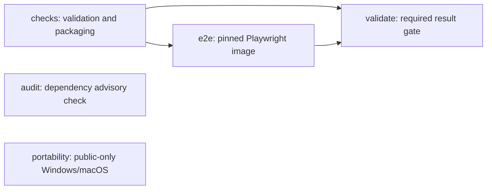

# CI architecture proposal — 2026-11-11

Status: implemented locally for review, not committed, pushed or exercised on a Linux runner. No Actions run, rerun, billing/protection change, deployment or publication was requested. The original working tree remains preserved; changes are in the isolated checkout on ci/develop-validation-release-safety, based on 8664d98.

## Diagnosis

Run [43045797454](https://github.com/sarangp3010/open-skill-kit/actions/runs/43045797454) passed all 366 unit/integration tests, moderation, licensing, fixture, catalog and production build checks. On the then-current ubuntu-latest image (Ubuntu 26.04.1), playwright install --with-deps chromium invoked apt. DNS resolution failed for azure.archive.ubuntu.com, archive.ubuntu.com and security.ubuntu.com. Ubuntu index/dependency downloads retried for approximately **10 minutes 5 seconds** before failing with apt exit 100; the overall step exited 1. Playwright tests and later npm/artifact checks did not run. This was an environment provisioning failure, not a failing browser test. Pinning the host OS alone cannot fix external DNS.

The CI mixed deterministic validation, package generation and browser provisioning in one job. Early browser setup failure obscured later packaging checks. Review events legitimately rerun moderation, but the security workflow lacked cancellation for superseded runs and audited PRs targeting any branch. check:duplicates and validate:skills invoke the exact same script/arguments, so running both in the same job repeated the same work.

## Alternatives

| Option                                                         | Benefits                                                                                                                                             | Limitations, security and cost                                                                                                                                                                                           | Decision                                                                                       |
| -------------------------------------------------------------- | ---------------------------------------------------------------------------------------------------------------------------------------------------- | ------------------------------------------------------------------------------------------------------------------------------------------------------------------------------------------------------------------------ | ---------------------------------------------------------------------------------------------- |
| Official, version/digest-pinned Playwright job image           | Includes the matching browsers and Linux system libraries; removes per-run apt/browser installation; separates diagnosis from application validation | A cold run still downloads a substantial image and npm dependencies. Registry/network failure remains possible. Needs a supported Linux Docker job runtime; a container is not a free runner or a security certification | Recommended for hosted E2E, within the existing owner-controlled $0 safeguards                 |
| Pinned Ubuntu host, browser-only installation or host Chrome   | Less container orchestration; may reuse installed libraries/Chrome                                                                                   | Host software revisions and system dependency coverage can drift. System Chrome need not match the Playwright Chromium build. Reintroducing --with-deps preserves the failing apt path                                   | Not chosen as the default                                                                      |
| Browser/dependency caches                                      | Potential warm download reduction                                                                                                                    | Browser caches do not contain apt-installed libraries; cache restore overhead can approach download time. Adds storage/trust/invalidation complexity and does not fix cold-run DNS                                       | Not added                                                                                      |
| Full browser tests locally, lightweight hosted validation only | Local execution has no Actions usage; fastest hosted path                                                                                            | Local passing results do not enforce E2E against an untrusted PR head. Removing E2E from the required gate would weaken the current policy                                                                               | Keep local E2E mandatory before any separately authorized push; do not replace hosted coverage |
| Self-hosted runner/custom image infrastructure                 | Could preserve installed dependencies                                                                                                                | Persistent untrusted PR execution risks host compromise; hardware, electricity, maintenance and applicable software licensing are not automatically $0. Custom image builds need their own patching/trust process        | Not introduced                                                                                 |

The [official Docker guidance](https://playwright.dev/docs/docker) documents included browsers/libraries and matching package/image versions. Its root-user configuration disables Chromium's sandbox; this proposal uses a non-root UID and gives no privileged capabilities or host Docker socket. This does not make arbitrary PR code trusted. The [CI guidance](https://playwright.dev/docs/ci) explains why browser caching does not eliminate Linux dependency installation.

## Recommended job graph



- **checks:** existing contribution/moderation, founding/release, lint/format/types, unit tests, portability/licensing, offline evaluations, schema/reference/duplicate/catalog, build/export, asset, npm packaging, artifact notice and catalog-diff checks. Only the redundant check:duplicates alias invocation is removed; validate:skills and contribution duplicate detection remain. No receipt, parser or publication code is changed.
- **e2e:** starts only after checks succeeds, so a syntax/security failure cannot cause an unnecessary image pull. The full existing browser/accessibility suite runs on the same event checkout in a separate read-only job. No apt, browser install, lifecycle scripts, shared cache or uploaded build artifact. Node 22 is selected explicitly; pnpm 10.20.0 is installed under RUNNER_TEMP without requiring root. The frozen lockfile still installs JavaScript dependencies.
- **validate:** preserves the existing check name. Runs with always() and succeeds only when both checks and e2e return success. Failed, skipped or cancelled prerequisites fail the gate. It performs no checkout or untrusted application execution. The unit test executes this gate's actual shell for all sixteen combinations of dependency outcomes. No branch-protection change is needed to retain the existing validate context; existing audit/native contexts remain named as before. Their actual remote configuration is not asserted or modified.
- **audit:** existing free advisory check and weekly schedule retained. PR targets are limited to main/develop, matching CI; concurrency cancels superseded runs. No paid security product is substituted.
- **portability:** existing public-only Windows/macOS matrix remains. Skipping it in a private repository is not execution evidence. Main and develop continue to receive PR/push validation. Existing review submitted/dismissed events are retained to catch withdrawn/stale approvals, including before merge. Broad path skips or removing these checks solely to reduce usage were rejected.

Linux host labels are pinned to ubuntu-24.04 rather than a moving ubuntu-latest. Existing SHA-pinned checkout/setup-node actions, read-only tokens, non-persisted Git credentials, no shared cache and no privileged workflow events remain. Only checks/moderation receives the step-scoped GitHub read token. The E2E container uses --user 1001 --shm-size=1gb with a writable temporary HOME; no root, host IPC, SYS_ADMIN, Docker socket or deployment environment is requested. This is a disposable test environment, not a hardened platform for executing arbitrary external websites. The final validate gate is bounded to two minutes; E2E to ten. Public native job behavior is unchanged.

## Exact browser environment

The frozen lockfile resolves @playwright/test, playwright and playwright-core to **1.65.0**. The workflow uses:

```text
mcr.microsoft.com/playwright:v1.65.0-noble@sha256:6e3fb709361521eb27161606e6da6d2674e5e89fa16516cb37d6fdd91372273d
```

A read-only official-registry manifest request confirmed this index exists, verified the SHA-256 of its raw body and found Linux amd64/arm64 child manifests. **No image layers were downloaded or container launched.** The local Docker daemon is unavailable; its CLI reports a missing socket. No daemon, Docker Desktop subscription or alternative runtime was started or purchased.

Workflow tests compare the image version with the lockfile and require an immutable digest. When changing Playwright, update the frozen lockfile and reviewed image version/digest together, inspect the official manifest, and validate compatibility before authorizing any hosted run. Do not select whatever tag appears in a documentation example: the actual resolved dependency version is the source of truth. If the frozen lockfile/image diverge, validation fails instead of downloading another browser silently.

PLAYWRIGHT_BROWSERS_PATH points to /ms-playwright; PLAYWRIGHT_SKIP_BROWSER_DOWNLOAD is set. Registry and npm availability remain dependencies. Image fetching may still fail before any step and cannot be covered by an in-container command timeout. No automatic retry or fallback that suppresses errors was added.

## Local pre-push process

Use the existing full validation command before requesting permission to push:

```sh
pnpm install --frozen-lockfile --ignore-scripts
pnpm exec playwright install chromium
CI=true pnpm validate:all
```

Browser installation is a one-time/local-version-change prerequisite; it requires network access. pnpm validate:all includes the existing free registry advisory query. Those commands do not publish, deploy or authorize a push. For offline review with installed tools, run the same suite's local commands excluding only audit:dependencies and report that exclusion explicitly; do not describe it as a fresh advisory audit.

If another app owns port 5173, preserve it and select a free port:

```sh
CI=true PLAYWRIGHT_PORT=5184 pnpm test:e2e
```

The port override accepts only integer ports from 1 to 65535 and is used for both the server command and base URL. CI=true forbids focused .only tests and requires the test suite to launch its own server instead of reusing a potentially stale one. The suite has zero automatic retries and a five-minute overall cap, below its job timeout. No individual test assertions or timeouts were relaxed. Local HTML/browser behavior on macOS does not prove Linux-container launch behavior.

## Cost and authorization

The owner manually reported an account-wide $0 Actions budget, stop-usage enabled, alerts enabled and no payment method. This proposal does not change those settings or independently certify their current state. Docker/MCR does not supply free compute: private standard runner usage still draws from included allowances; extra jobs also have startup and rounding overhead. No larger, self-hosted or paid runner type, cache storage, artifact upload, service account, paid API, image-building service, registry subscription or infrastructure is added. No billing setting is raised to make a job start. If GitHub blocks execution, leave it blocked and use local checks. [GitHub billing](https://docs.github.com/en/billing/concepts/product-billing/github-actions) distinguishes public standard runners, private allowances and blocked usage without a payment method.

The source proposal can operate within those existing $0 controls; it cannot guarantee account-wide costs through YAML alone. No hosted execution is authorized until the owner reviews these changes and separately approves a commit/push under still-applicable safeguards. No manual dispatch, rerun, merge, deployment, publication, branch-protection edit or visibility change is part of this work. All 42 source skills remain drafts; main-only exact-package human approval and moderation gates are unchanged.

## Timing estimate and verification limits

The observed failed run spent approximately 2m45s reaching browser setup and then 10m05s failing apt installation. This design removes that exact apt path. A successful future run might take roughly **5–8 minutes** for checks, a cold image pull, JavaScript installation, E2E and the final gate; this is a planning estimate, not a benchmark or guarantee. A large cold image or slow registry can take longer, and the extra VM startups can make a healthy cached-host run faster than this design. Fast-check failures avoid E2E provisioning entirely. Existing cancellation limits redundant concurrent runs; PR/push validation and approval-dismissal coverage are preserved.

Linux image execution, non-root filesystem permissions, Node setup inside that container and actual hosted duration remain **unverified**. They require a future owner-approved execution or an approved local Linux runtime. The image manifest/version check and macOS tests do not substitute for that evidence. Local validation results and all changed paths are recorded in IMPLEMENTATION_STATUS.md; no hosted success is claimed for this proposal.

## Local results and changed files

Final offline validation on macOS arm64 with Node 22.23.4, pnpm 10.20.0, CI=true and PLAYWRIGHT_PORT=5184 passed all 22 commands: lint, format:check, typecheck, test, portability:check, licensing:check, contributions:check, moderation:check, founding:check, release:check, evaluate:fixtures, validate:skills, check:links, check:duplicates, catalog:check, build:marketplace, build, catalog:check-assets, test:e2e, pack:npm, build:pages and licensing:artifacts. Results include **368 unit/integration tests across 17 files**, **22 Playwright tests** including accessibility, all 42 skills, 20 offline fixture suites and local npm/Pages-path builds. The isolated-server Playwright check also passed separately in 35.9 seconds. No external advisory audit was rerun; no new online vulnerability conclusion is claimed. The final documentation formatting and local-link checks pass.

One initial CI=true local attempt failed before tests because a pre-existing app owned 5173. That app was preserved; the validated numeric port override resolved the conflict without reusing or killing it. No Linux/Docker/hosted test was run. Actual source packages, real publication ledger and generated catalog are unchanged: 42 drafts, zero publication decisions.

Changed paths:

- .github/workflows/ci.yml: separate checks and E2E; retain validate as the success-only dependency gate; pinned Linux host and matching official browser image; retain all meaningful validation, move packaging before browser provisioning, remove one duplicate alias invocation.
- .github/workflows/security.yml: pinned Linux host, main/develop PR filter and cancellation of superseded audits; audit and schedule retained.
- playwright.config.ts: CI-only focused-test rejection, zero retries, suite resource bound and validated local port override; assertions and individual test timeouts untouched.
- tests/community.test.ts: workflow security/command coverage, lockfile/image alignment and executable result-gate regressions for all sixteen outcomes.
- README.md and CONTRIBUTING.md: link to this architecture and local pre-push process.
- docs/community-readiness.md and docs/launch/GITHUB_SETTINGS.md: describe the new read-only job graph and preserve required check names; remove outdated deployment descriptions.
- docs/IMPLEMENTATION_STATUS.md and docs/CI_ARCHITECTURE.md: record comparison, evidence, local results, timing estimates, $0 controls and unverified Linux behavior.

No package dependency, lockfile, source skill, approval, deployment workflow, remote setting, commit or push was changed by this proposal. Changes remain local and uncommitted for owner review.
